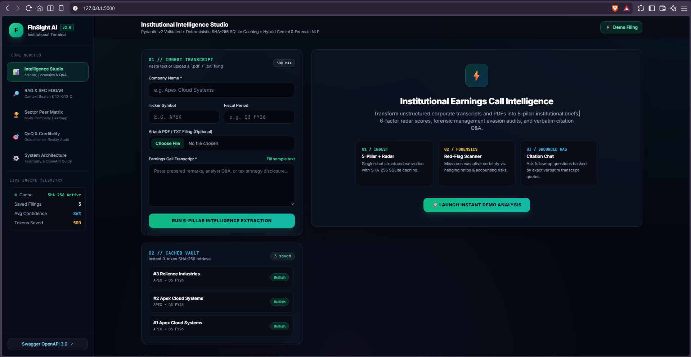
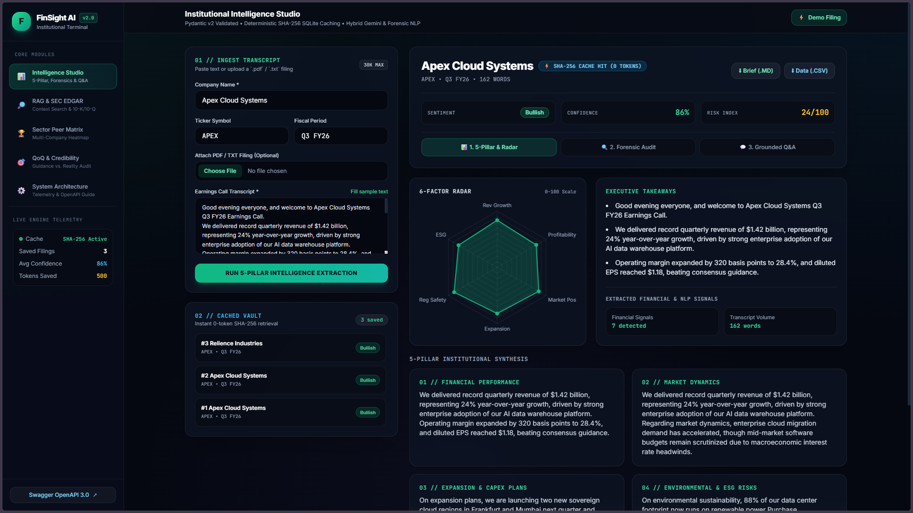
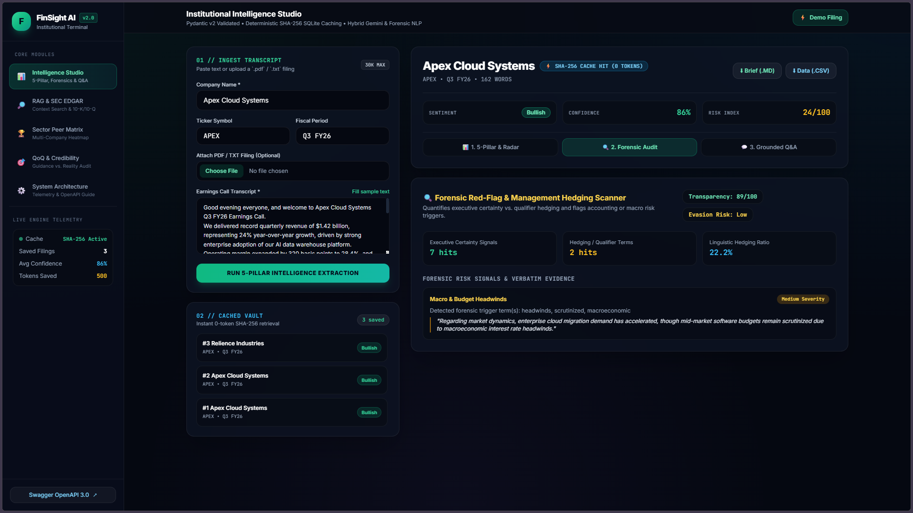
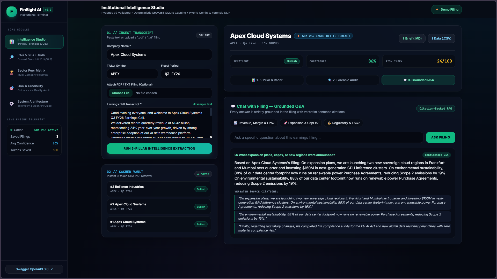
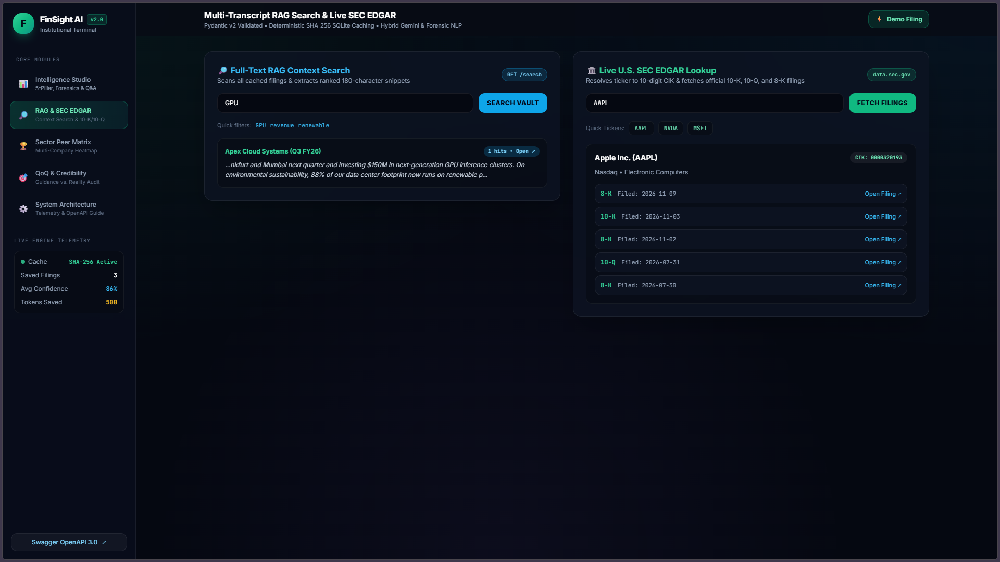
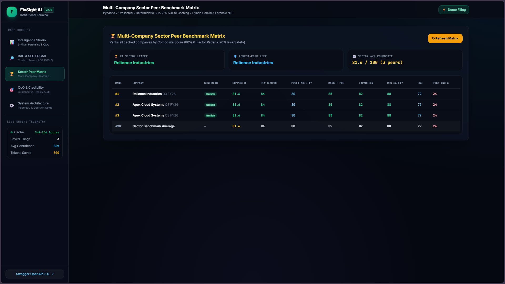
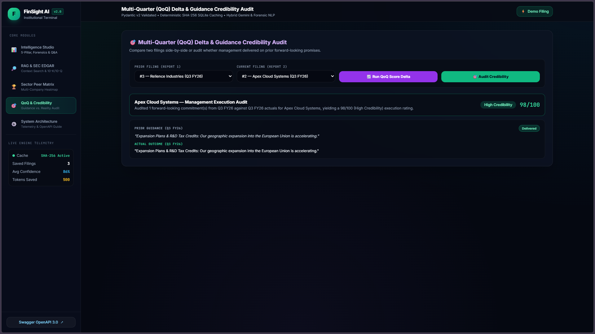
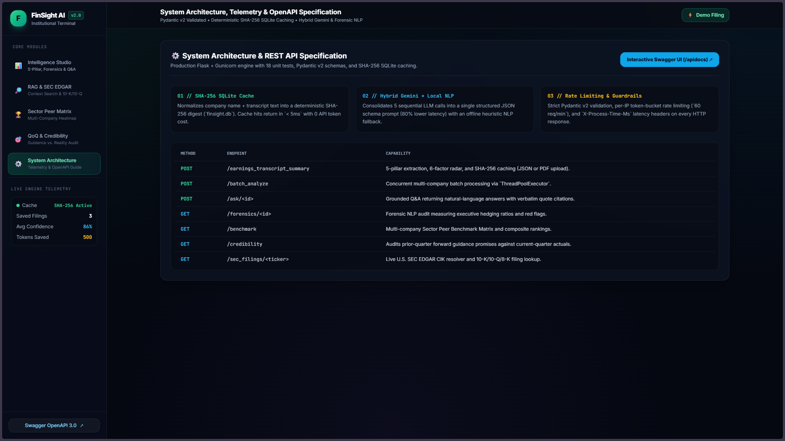

# FinSight AI — Institutional Earnings Call Intelligence, Forensic NLP & SEC EDGAR Platform


FinSight AI is an enterprise-grade financial intelligence platform built with Python, Flask, Pydantic v2, SQLite, and Google Gemini. Designed for institutional equity research, it ingests corporate earnings call transcripts (via raw text, PDF uploads, or concurrent batch payloads) to generate 5-pillar analytical summaries, 6-factor risk/growth radar matrices, forensic management hedging audits, grounded Q&A with verbatim sentence citations, multi-company sector peer benchmarks, multi-quarter guidance credibility audits, and live U.S. SEC EDGAR filing lookups.

**[Read the Complete Project Documentation & Technical Guide (PDF)](./Media/Documentation/Finsight%20AI%20Complete%20Project%20Documentation.pdf)**

---

## Platform Visual Walkthrough & Interface Gallery

| **1. Institutional Intelligence Studio** | **2. 5-Pillar Executive Summary & Radar** |
| :---: | :---: |
|  |  |
| **3. Forensic Red-Flag & Hedging Scanner** | **4. Grounded Q&A Chat (Verbatim Citations)** |
|  |  |
| **5. Full-Text RAG Search & Live SEC EDGAR** | **6. Multi-Company Sector Peer Matrix** |
|  |  |
| **7. Multi-Quarter Credibility Tracker** | **8. System Architecture & Swagger OpenAPI** |
|  |  |

---

## Key Engineering & Product Highlights

1. **80% API Latency & Quota Reduction:** Consolidates 5 sequential LLM calls into a single structured JSON schema prompt paired with a deterministic local heuristic NLP fallback engine.
2. **Content-Addressable SHA-256 SQLite Caching (`database.py`):** Normalizes and hashes every incoming transcript (`company_name + transcript_text`). Repeated analyses return in `< 5ms` while consuming **0 API tokens**.
3. **Grounded Q&A with Exact Quote Citations (`POST /ask/<id>`):** Answers natural-language analyst questions strictly grounded in the filing text, returning verbatim sentence citations to eliminate hallucinations.
4. **Forensic Red-Flag & Management Hedging Scanner (`GET /forensics/<id>`):** Computes an Executive Transparency Score (`0–100`), linguistic hedging-to-certainty ratios, and accounting/regulatory risk flags.
5. **Multi-Company Sector Peer Benchmark Matrix (`GET /benchmark`):** Ranks multiple cached companies from `#1 Sector Leader` to `#N`, computing composite scores and sector-wide averages across all 6 radar dimensions.
6. **Multi-Quarter Guidance vs. Reality Credibility Tracker (`GET /credibility`):** Cross-audits prior-quarter forward guidance commitments against subsequent-quarter actual performance (`Delivered`, `In Progress`, `Missed / Pivoted`).
7. **Live U.S. SEC EDGAR Connector (`GET /sec_filings/<ticker>`):** Resolves stock tickers (`AAPL`, `NVDA`, `MSFT`) to 10-digit SEC CIK identifiers and retrieves live 10-K, 10-Q, and 8-K filing URLs directly from `data.sec.gov`.
8. **Production Guardrails (`schemas.py` & `app.py`):** Strict Pydantic v2 validation, per-IP token-bucket rate limiting (`60 req/min`), `X-Process-Time-Ms` latency headers, Docker + Gunicorn deployment, and **18 automated offline unit tests**.

---

## System Architecture

```text
+-----------------------------------------------------------------------------------+
|                FinSight AI 5-Page Institutional Web Workspace                     |
|  1. Studio | 2. RAG & SEC EDGAR | 3. Sector Matrix | 4. Credibility | 5. System   |
+-----------------------------------------+-----------------------------------------+
                                          |
                                          v
+-----------------------------------------------------------------------------------+
|         Flask REST API + Token-Bucket Rate Limiter + Pydantic v2 (app.py)         |
|  POST /earnings_transcript_summary | POST /batch_analyze | POST /ask/<id>         |
|  GET  /forensics/<id>              | GET  /benchmark     | GET  /credibility      |
|  GET  /sec_filings/<ticker>        | GET  /search        | GET  /export/<id>      |
+--------------------+-----------------------------------------+--------------------+
                     |                                         |
          [1. SHA-256 Cache Lookup]                 [2. Cache Miss / Live Processing]
                     |                                         |
                     v                                         v
+------------------------------------+      +---------------------------------------+
|   SQLite Persistence & RAG Layer   |      |   Hybrid AI & Forensic NLP Engine     |
|           (database.py)            |      | (analyzer.py / sec_connector.py)      |
| - SHA-256 Content-Addressable Cache|      | - Single-Shot Gemini JSON + Fallback  |
| - Full-Text RAG Context Snippets   |      | - Forensic Hedging & Citation Scorer  |
| - Multi-Peer Sector Aggregation    |      | - Live SEC EDGAR CIK & Filing Lookup  |
+------------------------------------+      +---------------------------------------+
```

---

## Codebase & Media Structure

| File / Directory | Responsibility |
| :--- | :--- |
| `app.py` | Main Flask REST API, Token-Bucket Rate Limiter middleware, latency profiling headers, OpenAPI 3.0 spec (`/openapi.json`), and Swagger UI (`/apidocs`). |
| `analyzer.py` | Hybrid Gemini/Local NLP extraction engine, Grounded Q&A citation scorer, Forensic Red-Flag scanner, and Guidance Credibility evaluator. |
| `database.py` | SQLite persistence (`finsight.db`), SHA-256 caching, Full-Text RAG snippet search, Sector Peer Benchmark aggregation, and system telemetry. |
| `schemas.py` | Strict Pydantic v2 data models validating all request payloads and response contracts. |
| `sec_connector.py` | Live HTTP connector to `www.sec.gov` and `data.sec.gov` for CIK resolution and 10-K/10-Q/8-K filing retrieval. |
| `pdf_parser.py` | Local `.pdf` (`pypdf`) and `.txt` transcript text extraction and whitespace normalization. |
| `config.py` | Centralized environment configuration with `.env` support. |
| `templates/index.html` | Responsive 5-page dark-mode FinTech UI with Chart.js radar visualizations and 3-sub-tab report inspection. |
| `test_api.py` | **18 deterministic offline unit tests** covering every endpoint, edge case, and rate-limiter guardrail. |
| `Dockerfile` & `docker-compose.yml` | Production containerization running 4 Gunicorn workers under a non-root user. |
| `Media/Documentation/` | Contains the full technical guide (`FinSight AI Complete Project Documentation.pdf`). |
| `Media/Images/` | High-resolution screenshots (`1.png` – `8.png`) of all platform workflows. |

---

## Quickstart & Verification

### 1. Local Setup
```bash
git clone https://github.com/PijushPathak07/Python_and_Gen-AI.git
cd Python_and_Gen-AI
python -m venv venv
venv\Scripts\activate
pip install -r requirements.txt
```

### 2. Run the 18 Automated Unit Tests
```bash
python -m unittest test_api.py -v
```

### 3. Start the Application
```bash
python app.py
```
* **Main 5-Page Web Platform:** `http://127.0.0.1:5000`
* **Interactive Swagger / OpenAPI Docs:** `http://127.0.0.1:5000/apidocs`

---
**Author:** Pijush Pathak ([pijushpathak94@gmail.com](mailto:pijushpathak94@gmail.com))
